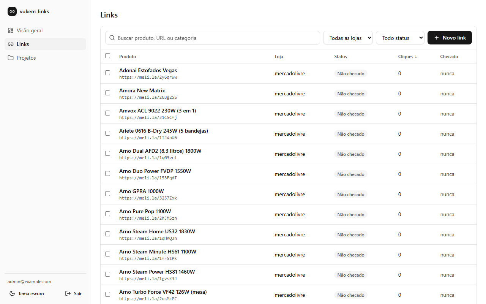

[](https://github.com/AlexGalhardo/vukem-links/actions/workflows/ci.yml)
[](LICENSE)

Dashboard open source para gerenciar links de afiliado usados em vários sites.

- **O link ainda existe?** Checagem de saúde de hora em hora, com fallback automático para o próximo link vivo.
- **Onde ele está?** Cada link pertence a um produto (página) de um projeto.
- **Quantos cliques?** Cada clique registra device, sistema, navegador, país e página de origem (sem IP). Bots não contam.

Todo clique passa por `GET /link?id=<id do produto>`, que redireciona (302) para o link de afiliado ativo. Os sites registram o catálogo no build com `PUT /api/v1/links?site=`.

## Screenshots

| Visão geral | Links |
| --- | --- |
|  |  |

## Quick start

### Docker

```bash
export APP_KEY="$(go run ./cmd/app key:generate)"
export ADMIN_PASSWORD=troque-esta-senha LINKS_API_KEY="$(openssl rand -hex 32)"
docker compose up -d --wait        # http://localhost:3000, dados no volume links-data
docker compose down                # -v apaga o volume
```

### Local

Requer Go, [Bun](https://bun.sh) e a CLI do vukem (`go install github.com/AlexGalhardo/vukem/cmd/vukem@v0.43.0`).

```bash
cp .env.example .env && vukem key:generate     # APP_KEY no .env; defina ADMIN_PASSWORD e LINKS_API_KEY
bun install
vukem migrate && vukem admin:create            # banco SQLite em storage/ e a conta de admin
vukem import:seed                              # opcional: os 381 links do seed.json
vukem serve                                    # http://localhost:3000
```

Login com `ADMIN_EMAIL` e `ADMIN_PASSWORD` do `.env`. Detalhes em [`docs/setup.md`](/docs/setup).

## Contrato da API

Resumo; o contrato completo (respostas, limites, formatos de importação) está em [`docs/api.md`](/docs/reference/api).

| Rota | Auth | Uso |
| --- | --- | --- |
| `GET /link?id=<externalId>[&store=<loja>]` | Pública | `302` para o link vivo de maior prioridade; `404` se o produto não existe |
| `GET /health` | Pública | `ok` ou `down`; os sites caem para a loja direto quando não responde |
| `PUT /api/v1/links?site=<origem>` | `Authorization: Bearer <LINKS_API_KEY>` | Sincronização completa do catálogo do site (cria, atualiza e remove) |
| `POST /api/v1/links?site=<origem>` | Idem | Acréscimo pontual, sem remover nada |

```bash
curl -X PUT "http://localhost:3000/api/v1/links?site=https://meusite.com"   -H "Authorization: Bearer $LINKS_API_KEY" -H "Content-Type: application/json"   -d '[{"externalId":"https://meusite.com/fones/x","links":[{"url":"https://amzn.to/abc123"}]}]'
```

O `site` precisa ser público e responder; chave única para todos os sites. Teste de ponta a ponta com um site real: [`docs/integration.md`](/docs/reference/integration).

## Stack

Go 1.27 · [vukem](https://github.com/AlexGalhardo/vukem) 0.43 (rotas, ORM, auth, scheduler) · Inertia 3 + React 19 + Tailwind CSS 4 com componentes no estilo shadcn/ui · SQLite · Bun (só para o frontend) · Playwright.

## Comandos

| Comando | O que faz |
| --- | --- |
| `vukem serve` | Desenvolvimento (Go + Vite com reload) |
| `go test ./...` | Testes Go: regras, catálogo, saúde, API, redirect, login e páginas |
| `golangci-lint run` | Lint Go |
| `bun run typecheck` / `lint:js` / `build` | Frontend |
| `bun run e2e` | Fluxo principal no navegador (Playwright) |
| `bash scripts/smoke.sh` | Smoke da imagem Docker |
| `bash scripts/integration-smoke.sh` | Sync real do eletroradar contra o dashboard, clique 302 e clique no banco |
| `app admin:create` | Cria o admin (`ADMIN_EMAIL`/`ADMIN_PASSWORD`), sem alterar senha existente |
| `app import:seed` / `import:legacy -from <arquivo>` | Importa o `seed.json` / o banco da versão anterior ([`docs/migration.md`](/docs/migration)) |

## Documentação

| | |
| --- | --- |
| [Site de docs](https://alexgalhardo.github.io/vukem-links/) | Esta documentação publicada (`site/`) |
| [`PLAN.md`](https://github.com/AlexGalhardo/vukem-links/blob/main/PLAN.md) | Estado atual, pendências e próximos passos |
| [`CHANGELOG.md`](/changelog) | Histórico de versões |
| [`docs/setup.md`](/docs/setup) | Variáveis de ambiente, local e Docker |
| [`docs/architecture.md`](/docs/reference/architecture) | Estrutura, modelo de dados e fluxos |
| [`docs/api.md`](/docs/reference/api) | Redirect, API de cadastro (contrato com os sites) e importação |
| [`docs/health-check.md`](/docs/reference/health-check) | Como um link é considerado vivo ou morto |
| [`docs/auth.md`](/docs/reference/auth) | Login do administrador |
| [`docs/integration.md`](/docs/reference/integration) | Smoke de integração com os sites |
| [`docs/migration.md`](/docs/migration) | Migração do Next.js/Turso para o vukem |
| [`docs/tooling.md`](/docs/project/tooling) | Ferramentas e configuração |
| [`docs/workflows.md`](/docs/project/workflows) | Commit, release e deploy |
| [`docs/conventions.md`](/docs/project/conventions) | SemVer, changelog e commits |
| [`docs/brainstorming.md`](/docs/project/brainstorming) | Decisões de produto e da reescrita |
| [`.claude/agents.md`](https://github.com/AlexGalhardo/vukem-links/blob/main/.claude/agents.md) | Guia para agentes de código |

## Contribuindo

Veja [`CONTRIBUTING.md`](/docs/project/contributing) (setup, fluxo, checagens) e o [`CODE_OF_CONDUCT.md`](/docs/project/code-of-conduct). Vulnerabilidades: [`SECURITY.md`](/docs/project/security), nunca em issue pública.

## Licença

[MIT](LICENSE).
