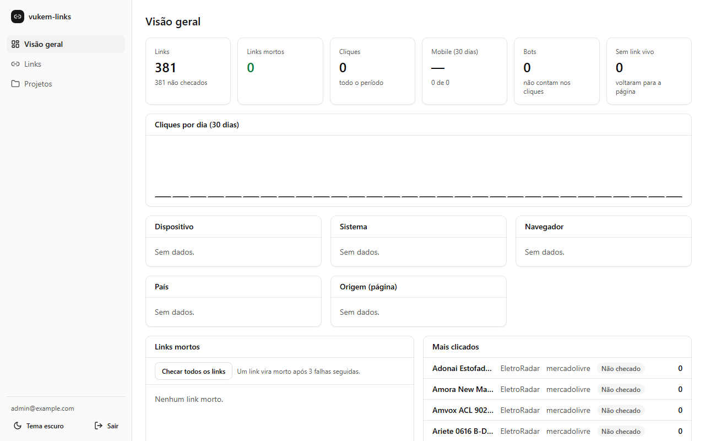

## Introduction

vukem-links is a personal, open source dashboard for the affiliate links used across several websites. It answers three questions: is the link still alive, where is it (project and page), and how many clicks did it get, on desktop or mobile.

Every click goes through `GET /link?id=<product id>`, which redirects (302) to the active affiliate link. The websites register their catalog at build time with `PUT /api/v1/links?site=`.

The application is written in Go on the [Vukem framework](https://vukem.dev), with an Inertia 3, React 19 and Tailwind CSS 4 dashboard (shadcn/ui-style components written in the repository), SQLite and Playwright. The dashboard interface is in Brazilian Portuguese. The full documentation is at [https://alexgalhardo.github.io/vukem-links/](https://alexgalhardo.github.io/vukem-links/).

| Overview | Links |
| --- | --- |
|  |  |

## Summary

- [Introduction](#introduction)
- [Features](#features)
- [Quick start](#quick-start)
- [API contract](#api-contract)
- [Documentation](#documentation)
- [Stability](#stability)
- [Contributing](#contributing)
- [Code of conduct](#code-of-conduct)
- [Security vulnerabilities](#security-vulnerabilities)
- [License](#license)

## Features

- Hourly health check of every link, with automatic fallback to the next live link.
- Each link belongs to a product (page) of a project; a new website becomes a project on its first sync.
- Each click records device, operating system, browser, country and referring page (never the IP). Bots do not count.
- Single admin login, weekly Telegram report and alerts for dead links.
- Import of the legacy `seed.json` and of the database of the previous Next.js version.

## Quick start

Docker:

```sh
export APP_KEY="$(go run ./cmd/app key:generate)"
export ADMIN_PASSWORD=change-this-password LINKS_API_KEY="$(openssl rand -hex 32)"
docker compose up -d --wait        # http://localhost:3000, data in the links-data volume
docker compose down                # -v deletes the volume
```

Local, with Go, [Bun](https://bun.sh) and the Vukem CLI (`go install github.com/AlexGalhardo/vukem/cmd/vukem@v0.43.0`):

```sh
cp .env.example .env && vukem key:generate     # APP_KEY in .env; set ADMIN_PASSWORD and LINKS_API_KEY
bun install
vukem migrate && vukem admin:create            # SQLite database in storage/ and the admin account
vukem import:seed                              # optional: the 381 links of seed.json
vukem serve                                    # http://localhost:3000
```

Sign in with `ADMIN_EMAIL` and `ADMIN_PASSWORD` from `.env`. Details in [docs/setup.md](/docs/setup).

Checks:

```sh
go vet ./... && go test ./...
golangci-lint run
bun run typecheck && bun run lint:js && bun run build
bun run e2e                          # main flow in the browser (Playwright)
bash scripts/smoke.sh                # Docker image smoke
bash scripts/integration-smoke.sh    # real eletroradar sync against the dashboard, 302 click and click in the database
```

## API contract

Summary; the full contract (responses, limits, import formats) is in [docs/api.md](/docs/reference/api).

| Route | Auth | Use |
| --- | --- | --- |
| `GET /link?id=<externalId>[&store=<store>]` | Public | `302` to the live link with the highest priority; `404` if the product does not exist |
| `GET /health` | Public | `ok` or `down`; the websites fall back to the store link when it does not answer |
| `PUT /api/v1/links?site=<origin>` | `Authorization: Bearer <LINKS_API_KEY>` | Full sync of the website catalog (creates, updates and removes) |
| `POST /api/v1/links?site=<origin>` | Same | One-off addition, removes nothing |

```sh
curl -X PUT "http://localhost:3000/api/v1/links?site=https://mysite.com" \
  -H "Authorization: Bearer $LINKS_API_KEY" -H "Content-Type: application/json" \
  -d '[{"externalId":"https://mysite.com/headphones/x","links":[{"url":"https://amzn.to/abc123"}]}]'
```

The `site` must be public and answer; one key serves every website. End-to-end test with a real website: [docs/integration.md](/docs/reference/integration).

## Documentation

- [Docs site](https://alexgalhardo.github.io/vukem-links/): this documentation, published from `site/`.
- [PLAN.md](https://github.com/AlexGalhardo/vukem-links/blob/main/PLAN.md): current state, pending work and next steps.
- [docs/setup.md](/docs/setup), [docs/architecture.md](/docs/reference/architecture), [docs/api.md](/docs/reference/api) and [docs/health-check.md](/docs/reference/health-check).
- [docs/auth.md](/docs/reference/auth), [docs/integration.md](/docs/reference/integration) and [docs/migration.md](/docs/migration) (from Next.js/Turso to Vukem).
- [docs/tooling.md](/docs/project/tooling), [docs/workflows.md](/docs/project/workflows), [docs/conventions.md](/docs/project/conventions) and [docs/brainstorming.md](/docs/project/brainstorming).
- [.claude/agents.md](https://github.com/AlexGalhardo/vukem-links/blob/main/.claude/agents.md): guide for AI agents.

## Stability

vukem-links follows [Semantic Versioning](https://semver.org) and tags releases as `vX.Y.Z` on `main`. Changes are listed in [CHANGELOG.md](/changelog), which follows [Keep a Changelog](https://keepachangelog.com/en/1.1.0/). Release notes are the matching CHANGELOG section. The public contract (`/link`, `/api/v1/links`, `/health`) is fixed by `tests/api_test.go`.

## Contributing

Thank you for considering a contribution.

- Open an issue first for anything that changes the public contract ([docs/api.md](/docs/reference/api)).
- Write the test first. Run the specific test, lint and typecheck that cover your change.
- Update `CHANGELOG.md` (under `[Unreleased]`) and the documentation in the same change when behavior, commands or conventions change.

The full guide (setup, checks, rules) is in [CONTRIBUTING.md](/docs/project/contributing).

### Pull requests

1. Create a branch from `main`.
2. Make one logical change per commit.
3. Open a pull request against `main`; its title is a Conventional Commit.

`main` accepts changes only through a pull request with green required checks and linear history.

### Commits

Use [Conventional Commits](https://www.conventionalcommits.org/en/v1.0.0/) in English: `type(scope): description`.

- Types: `feat`, `fix`, `perf`, `refactor`, `docs`, `test`, `build`, `ci`, `chore`, `style`, `revert`.
- Scopes: `api`, `link`, `health`, `catalog`, `dashboard`, `auth`, `telegram`, `legacy`, `docker`, `ci`, `site`, `deps`, `docs`.

## Code of conduct

To keep the community welcoming to everyone, please review and follow the [Code of Conduct](/docs/project/code-of-conduct).

## Security vulnerabilities

If you discover a security vulnerability, please follow the [security policy](/docs/project/security) instead of opening a public issue.

## License

vukem-links is open source software released under the [MIT license](LICENSE).
